  

  
  

Python backend developer · Telegram bots, Mini Apps, FastAPI

### Projects

[**shelfwatch**](https://github.com/qweendev/shelfwatch) is a Telegram bot that tells you when something is back in stock or gets cheaper. You send it a link and it does the rest.

### Stack

  
  
  
  
  
  

